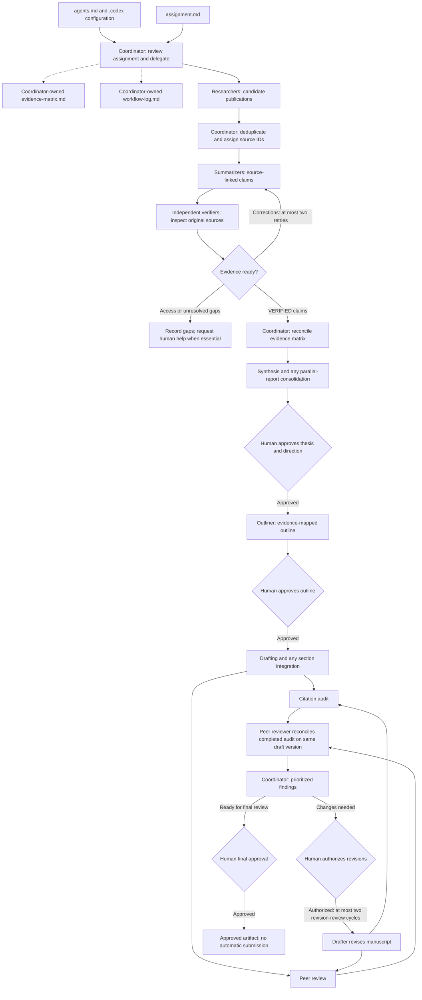

# ResearchFactory

ResearchFactory is a Codex-driven workflow for academic research, evidence verification, synthesis, and manuscript review. A coordinating agent delegates work to eight specialist agents, maintains shared records, and pauses for human decisions at defined checkpoints.

The repository contains instructions and configuration rather than a standalone application. Opening it does not automatically run a research project. The human author remains responsible for research direction, interpretation, academic integrity, and final writing decisions. Nothing is submitted automatically.

The current [demonstration assignment](papers/paper-001/assignment.md) is a 1,200-word, APA 7 review of techniques for detecting and reducing hallucinations in large language models. It calls for at least three relevant scholarly publications and explicitly identifies the paper as an AI-generated demonstration. The repository currently contains the assignment and an empty evidence-matrix template, not a completed research paper.

## Repository layout

Existing files:

```text
ResearchFactory/
├── readme.md
├── agents.md
├── .codex/
│   ├── config.toml
│   └── agents/
│       ├── researcher.toml
│       ├── summarizer.toml
│       ├── verifier.toml
│       ├── synthesizer.toml
│       ├── outliner.toml
│       ├── drafter.toml
│       ├── citation-auditor.toml
│       └── peer-reviewer.toml
└── papers/
    └── paper-001/
        ├── assignment.md
        └── evidence-matrix.md
```

Artifacts generated during a run, inside the assigned paper directory:

```text
workflow-log.md
research/candidates/<topic>.md
summaries/SRC-###.md
reviews/verification/SRC-###.md
research/synthesis.md
outline.md
draft.md
reviews/citation-audit.md
reviews/peer-review.md
```

Parallel tasks may additionally produce `research/synthesis-<topic-slug>.md` and `draft-sections/<section-slug>.md`. Permitted local source copies may be referenced from the evidence matrix; inaccessible publications are recorded as access limitations.

## How the files work together

| File | Purpose |
| --- | --- |
| [agents.md](agents.md) | Shared orchestration instructions: phase order, evidence rules, ownership, logging, approval gates, and stopping conditions. This is the workspace instruction file referred to as AGENTS.md in prompts. |
| [.codex/config.toml](.codex/config.toml) | Enables agents, requests live web search, and limits concurrently open spawned-agent threads to three, excluding the coordinator. |
| Agent TOML definitions in [.codex/agents](.codex/agents) | Define each specialist's responsibilities, inputs, evidence boundaries, output files, and handoff requirements. |
| [assignment.md](papers/paper-001/assignment.md) | Defines the individual paper's research question, scope, source requirements, length, citation style, and permitted AI use. |
| [evidence-matrix.md](papers/paper-001/evidence-matrix.md) | Coordinator-maintained source register, claim ledger, verification statuses, cross-source relationships, manuscript mappings, and unresolved evidence issues. |
| `workflow-log.md` | Created when research begins. The coordinator records agent contributions, sources used, verification outcomes, human decisions, and outstanding issues with timezone-qualified timestamps and artifact links. |

Each agent TOML file has three core fields:

- `name`: the role identifier used when delegating, such as `citation_auditor`.
- `description`: guidance for selecting that specialist.
- `developer_instructions`: the detailed role instructions, including required inputs, allowed outputs, and stopping conditions.

The filename and role name need not be identical: `peer-reviewer.toml` defines `peer_reviewer`. The current definitions do not specify separate model overrides.

The coordinator is the primary Codex agent, not a ninth custom TOML role. It reads the assignment and shared instructions, assigns bounded tasks, collects specialist handoffs, and manages approvals. The assignment supplies paper-specific requirements; the shared instructions supply the process; the TOML definitions supply specialist behavior. Missing essential requirements are surfaced rather than invented.

## Workflow diagram



The coordinator manages the whole sequence and updates the matrix and log as work progresses. Approval diamonds are stopping points: no dependent work starts without approval. Independent source tasks and the two manuscript reviews can overlap, but integration and final verdicts wait for their inputs. Unresolved evidence is retained as a gap and cannot support conclusions.

## Agent reference

Output paths below are relative to the assigned paper directory.

| Agent definition | Responsibility and dependencies | Output |
| --- | --- | --- |
| [researcher](.codex/agents/researcher.toml) | Finds and evaluates publications from the assignment and a coordinator-assigned search scope/report slug. Records bibliographic verification and access limitations. | `research/candidates/<topic>.md` |
| [summarizer](.codex/agents/summarizer.toml) | Extracts findings from an assigned publication after receiving its permanent source ID and metadata from the coordinator. Does not verify its own claims. | `summaries/SRC-###.md` |
| [verifier](.codex/agents/verifier.toml) | Independently inspects original full text and checks the completed summary's claims, numbers, quotations, and limitations. | `reviews/verification/SRC-###.md` |
| [synthesizer](.codex/agents/synthesizer.toml) | Compares VERIFIED evidence, identifies disagreements and gaps, and proposes tentative thesis options. | `research/synthesis.md`, or assigned `research/synthesis-<topic-slug>.md` for parallel work |
| [outliner](.codex/agents/outliner.toml) | Uses the approved thesis, synthesis, assignment, and VERIFIED evidence to create a structured outline for approval. | `outline.md` |
| [drafter](.codex/agents/drafter.toml) | Writes from the approved thesis and outline, permitted AI-use rules, and VERIFIED claims. A designated drafter integrates parallel sections. | `draft.md`, or assigned `draft-sections/<section-slug>.md` |
| [citation_auditor](.codex/agents/citation-auditor.toml) | Checks a stable manuscript's source support, numerical claims, quotations, metadata, and citation style against the sources. | `reviews/citation-audit.md` |
| [peer_reviewer](.codex/agents/peer-reviewer.toml) | Evaluates a stable manuscript's argument, synthesis, organization, and assignment coverage. A final PASS also requires a passing citation audit for that version. | `reviews/peer-review.md` |

## Complete walkthrough

1. **Review the assignment.** The coordinator reads its question, requirements, source constraints, and AI-use rules. Essential ambiguities are resolved before dependent work begins. The workflow log starts when research begins.
2. **Discover publications.** Researchers investigate assigned topics and produce candidate reports. They distinguish publication metadata verification from verification of research findings.
3. **Deduplicate and assign IDs.** The coordinator compares candidates across reports and against the source register, using DOI first, then canonical URL and bibliographic metadata. Existing publications retain their IDs; ambiguous matches await clarification.
4. **Summarize each source.** Summarizers extract claims with source locations and qualifications. Claims begin as `PENDING_VERIFICATION`. An abstract-only source can receive a preliminary synopsis, not a full-paper summary.
5. **Verify independently.** A different specialist checks the summary against the original publication. The summarizer owns corrections; the verifier owns its report. Failed verification may be retried at most twice. Unresolved claims remain ineligible for factual support.
6. **Reconcile the evidence matrix.** The coordinator merges traceable claim assessments and preserves IDs. Materially changed claims return to pending verification until checked again.
7. **Synthesize and choose a thesis.** The synthesizer compares VERIFIED findings and proposes defensible directions. The coordinator consolidates separate reports if synthesis ran in parallel. The human reviews findings, gaps, and thesis options and approves the thesis and direction.
8. **Outline and approve.** The outliner maps the approved argument to evidence and assignment requirements. Drafting waits for human outline approval.
9. **Draft.** The drafter writes the complete manuscript. If parallel drafting is explicitly requested, workers write separate approved sections and one designated drafter integrates them before review.
10. **Run independent reviews.** The citation auditor and peer reviewer examine the same stable manuscript version. If peer review finishes while the citation audit is pending, the coordinator sends the completed audit back for a follow-up. The peer reviewer updates only its report and reassesses the verdict.
11. **Revise with authorization.** The coordinator presents prioritized findings. The human author authorizes revisions; the drafter applies them. Both reviews rerun after substantive revisions, for at most two revision-review cycles. An audit-dependency follow-up on an unchanged draft is part of the same cycle.
12. **Return for final approval.** Present the manuscript, audit results, source and claim counts, limitations, workflow log, and outstanding decisions. Remaining blockers after two revision-review cycles require human direction. A completed automated run is not submission approval.

## Getting started

Use a Codex environment that supports project-scoped custom agents and the tools needed to access permitted research sources. Open this repository as the workspace. There is no project application to install or build.

Review the shared instructions and configuration, then prepare the paper's assignment. Confirm its research scope, source expectations, citation style, target length, and AI-use permissions. Keep the evidence matrix as a clean template until the workflow populates it.

Start with a read-only preflight prompt:

```text
Read agents.md, .codex/config.toml, and all eight definitions in
.codex/agents/. Inspect papers/paper-001/assignment.md and
papers/paper-001/evidence-matrix.md.

Confirm agent availability, output ownership, dependencies, approval
checkpoints, and any conflicting or missing instructions.
Do not modify files, launch research tasks, or begin research.
```

When ready to begin, use a separate prompt:

```text
Begin the research workflow for papers/paper-001 according to agents.md
and assignment.md. Use the configured specialist agents. Keep all paper
artifacts inside papers/paper-001 and maintain workflow-log.md.

Perform discovery, independent evidence extraction and verification,
and synthesis. Present findings, evidence gaps, and proposed thesis
directions. Stop for my thesis and research-direction approval before
creating the outline. Do not draft or submit the paper.
```

After reviewing the synthesis, explicitly approve a thesis or request more research. Approve the outline separately before drafting. Do not treat a generic request to continue as permission to bypass the recorded approval gates.

## Evidence and concurrency rules

### Identifiers and traceability

- **Candidate:** `CAND-<report-slug>-001`, assigned within a researcher report using a unique coordinator-provided slug.
- **Source:** `SRC-001`, assigned only by the coordinator after deduplication. IDs are permanent and are never recycled for another publication.
- **Local claim:** `C001`, assigned by the summarizer within a source's summary.
- **Global claim:** `SRC-001-C001`, formed by the verifier by prefixing the source ID. Used in verification reports, the matrix, synthesis, outlines, and manuscript evidence mappings.

These are illustrative identifiers, not actual collected sources or findings. Two sources can each have a local `C001` without sharing a global claim ID. Corrections preserve the claim's ID and traceable mapping.

### Access and verification

| Access status | Meaning |
| --- | --- |
| `FULL_TEXT` | Complete publication available through a permitted source. |
| `ABSTRACT_ONLY` | Only the abstract is accessible. |
| `METADATA_ONLY` | Only bibliographic information is accessible. |
| `RESTRICTED` | Required access is unavailable or not permitted. |

| Claim status | Meaning | May support synthesis or a manuscript? |
| --- | --- | --- |
| `PENDING_VERIFICATION` | Extracted but not independently checked. | No |
| `VERIFIED` | Original full-text evidence supports the claim with its qualifications. | Yes |
| `PARTIALLY_SUPPORTED` | Evidence exists, but wording or details need correction. | No |
| `UNSUPPORTED` | Inspected evidence does not support the claim. | No |
| `UNVERIFIABLE` | Access, legibility, or location prevents reliable checking. | No |

`LOCATION_UNCONFIRMED` belongs in the summary's **Source Location** field, with available details and an explanation. It is not a verification status: the summary remains `PENDING_VERIFICATION`. The verifier searches independently and records the actual location and assessment, or `UNVERIFIABLE` if it cannot reliably locate the evidence. Finding a location alone does not establish support.

An AI-generated summary is not verified evidence. The evidence matrix provides traceability and does not replace the original publications. Citation-audit support labels and whole-report verdicts are separate from the claim-verification statuses above.

### Parallel work and ownership

The configured limit is three concurrently open spawned-agent threads, in addition to the coordinator. Eight available roles do not imply eight simultaneous workers.

Independent searches, summaries for different sources, and verifications of different stable summaries may overlap. Summarizing one source can overlap with verifying another. Do not change a summary while its verifier is checking it.

Parallel synthesis workers own distinct topic reports. After they finish, the coordinator writes the separate consolidated `research/synthesis.md`, preserving the originals. In a single-agent run, the synthesizer owns that canonical file instead.

Parallel drafting begins only after the same approval gates as ordinary drafting. Section workers own separate files. One designated drafter integrates stable sections into `draft.md`, preserving the inputs and checking the complete argument, references, mappings, and length.

Citation auditing and initial peer review may overlap. Final peer-review PASS waits for a passing citation audit covering the same manuscript version and satisfaction of the peer review's own criteria. If the manuscript changes, reviews must cover the new stable version.

Only the coordinator writes the shared evidence matrix and workflow log. Specialists provide handoffs, never overwrite one another's reports, and never concurrently write the same file.

## Starting another paper

1. Create a new directory such as `papers/paper-002/`.
2. Add an `assignment.md` defining that paper's question, requirements, source constraints, and AI-use policy.
3. Add a clean `evidence-matrix.md` using the existing template structure. Clear paper-specific records and metadata if copying from a completed project; do not carry over verification claims as though they belong to the new paper.
4. Run the preflight prompt with the new directory, then explicitly request research there.

Keep existing paper artifacts intact. Each paper has its own source register, log, summaries, and reviews. The shared agent definitions are reusable; the assigned paper directory determines the destination of their work.

## Limits and completion

- Only VERIFIED claims support factual conclusions in the synthesis, outline, and manuscript.
- Human approval is required for the thesis/direction, outline, manuscript revisions, and final manuscript. Existing human edits cannot be overwritten without authorization.
- Verification allows an initial assessment and at most two retries. Substantive manuscript revision and review allow at most two cycles after the initial draft reviews.
- Respect copyright, licensing, access restrictions, and the assignment's AI-use rules. Do not bypass authentication or paywalls, and do not represent abstract access as full-text inspection.
- The demonstration assignment permits AI-generated writing, but inclusion in another assignment must also comply with that assignment's rules.
- Review PASS means the defined checks passed; it does not prove originality, guarantee scientific correctness, or replace human judgment.

The final handoff reports sources collected, sources with verified full-text evidence, verified and unresolved claims, evidence limitations, completed artifacts, both review outcomes, workflow-log location and gaps, and outstanding human decisions. The human author decides whether the manuscript is ready. The workflow never submits it automatically.
